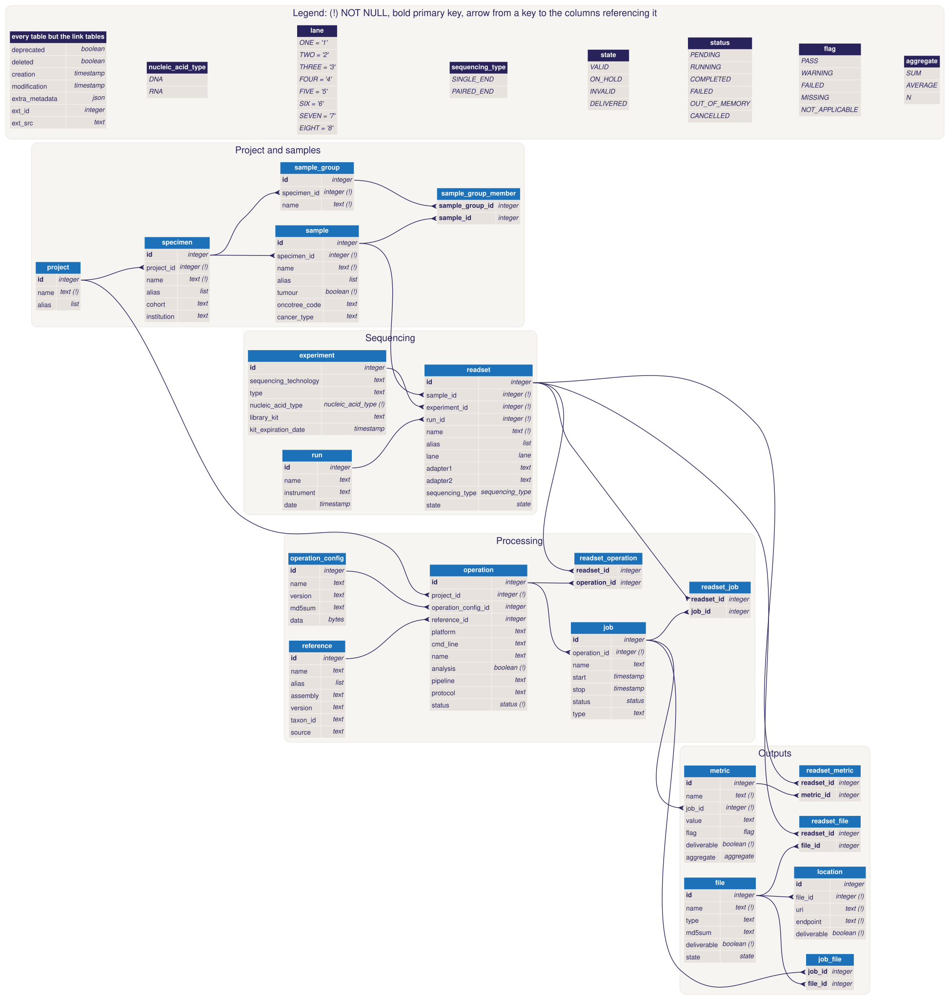

# Project Tracking



The diagram is generated from the models (`project_tracking/model.py`). It reads as a pipeline, left to
right: project and samples, sequencing, processing, then outputs (the stages are `STAGES` in
`project_tracking/dbml.py`; a new table must be added to one). Each arrow goes from a key to the columns
referencing it, with a crow's foot on the many side. `docs/database.dbml` describes the same database in
[DBML](https://dbml.dbdiagram.io/docs/): paste it in [dbdiagram.io](https://dbdiagram.io) to explore it
interactively.

After a model change, regenerate both from the repository root (the SVG needs Node.js):

```bash
utils/update_database_diagram.sh
```

`tests/test_dbml.py` fails while `docs/database.dbml` doesn't match the models or a table is in no stage, and
the Database Diagram workflow fails while either file is out of date.

## API

[openapi.json](./openapi.json) describes every route of the API in the [OpenAPI 3](https://spec.openapis.org/oas/v3.0.3)
format. It's generated from the routes: open it in any OpenAPI viewer, e.g. paste it in
[editor.swagger.io](https://editor.swagger.io), or browse `/docs` on a running API. After a route change, regenerate it:

```bash
flask --app project_tracking openapi -o docs/openapi.json
```

`tests/test_openapi.py` fails while it's out of date.
